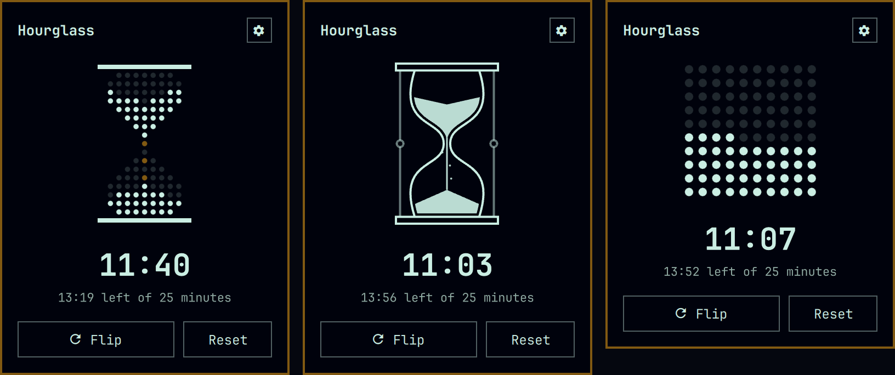
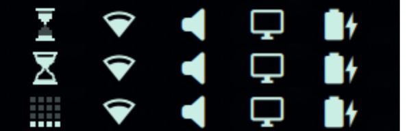

# Hourglass: Sands of Time

An hourglass for the [Omarchy](https://omarchy.org) bar. Flip it, and it shows how much time has run through since. A notification tells you when it runs out.



## Styles

Pick one in the panel's settings, or press `t` in the panel to step through them.

- **Matrix** (default): an hourglass made of dots. Lit dots are sand. Dots move from the top bulb to the bottom one, and the neck and the falling grains take the theme's accent colour.
- **Turned**: a drawn glass with curved bulbs, caps and posts. The sand dips as it drains, piles into a cone below, and falls in a thin stream.
- **Square**: not an hourglass at all. A 10 × 10 square of dots lights up from the bottom, one dot per percent of the time.

The bar icon follows the chosen style and moves in quarters, so it stays readable at bar size:



Everything is drawn in the current theme's colours, so it follows theme changes.

## Install

```bash
omarchy plugin add https://github.com/tdhftw/omarchy-hourglass.git --enable
```

It lands on the right side of the bar. Move it with `omarchy bar move tdh.hourglass --section <section>`, or drag it along the bar.

It needs nothing beyond Omarchy itself: the shell, and `omarchy-notification-send` for the run-out notification. It makes no network requests.

## Remove

```bash
omarchy plugin remove tdh.hourglass
```

To keep it installed but hide it, use `omarchy plugin disable tdh.hourglass` instead.

## Using it

| Where | Action | What it does |
| --- | --- | --- |
| Bar | Left click | Open the panel |
| Bar | Right click | Flip the glass |
| Panel | `Enter`, `Space` or `f` | Flip the glass |
| Panel | `x` | Reset to unflipped |
| Panel | `t` | Next style |
| Panel | `s` or the cog | Settings |
| Settings | `←` / `→` | One minute less / more |
| Settings | `↑` / `↓` | Five minutes more / less |
| Settings | `Enter` or `Esc` | Back to the glass |

Flipping always starts again from a full glass. After the sand runs out, the time keeps counting, so you can see how long ago it finished, and the bar icon turns the theme's urgent colour until you flip or reset it.

The panel shows the time since the flip and how much is left. Settings set how long the glass takes to empty, from 1 to 720 minutes, with presets for 5, 15, 25, 45 and 60. A change applies to a glass that is already running.

## When it runs out

The plugin sends a desktop notification through `omarchy-notification-send` at the moment the sand runs out. It is sent as critical, because the Omarchy notification daemon only keeps critical notifications on screen until you dismiss them. Do Not Disturb still holds it back.

- If the machine was asleep at that moment, the notification comes as soon as it wakes.
- Each flip notifies once, even across shell restarts or with a bar on several monitors.
- If the shell starts more than 10 minutes after a glass ran out, that run is not announced.

## Settings

The widget keeps its settings and state in its entry in `~/.config/omarchy/shell.json`:

| Key | Meaning |
| --- | --- |
| `style` | `matrix`, `turned` or `square` |
| `durationMinutes` | Minutes until the glass is empty, 1 to 720 |
| `flippedAt` | When the glass was last flipped, in epoch milliseconds; `0` when unflipped |
| `notifiedFor` | The flip whose run-out has been announced |

Because the flip time is stored there, a running glass survives a shell restart.

## Translations

Strings live in `i18n/`, one file per Omarchy language code. English is the only one so far; a missing language falls back to English. To add one, copy `i18n/en.json` to the new code (for example `i18n/sv.json`) and translate the values.

## Files

| File | What it holds |
| --- | --- |
| `manifest.json` | Plugin manifest |
| `BarWidget.qml` | The bar icon; owns the state, the timers and the notification |
| `Panel.qml` | The panel and its settings view |
| `Hourglass.qml` | Picks the drawing for the chosen style |
| `HourglassMatrix.qml`, `HourglassTurned.qml`, `HourglassSquare.qml` | The three drawings |
| `Model.js` | Time arithmetic and the geometry for all three styles |

## License

[MIT](LICENSE)
